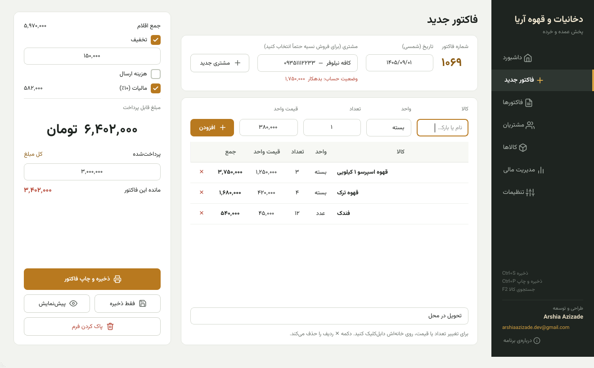
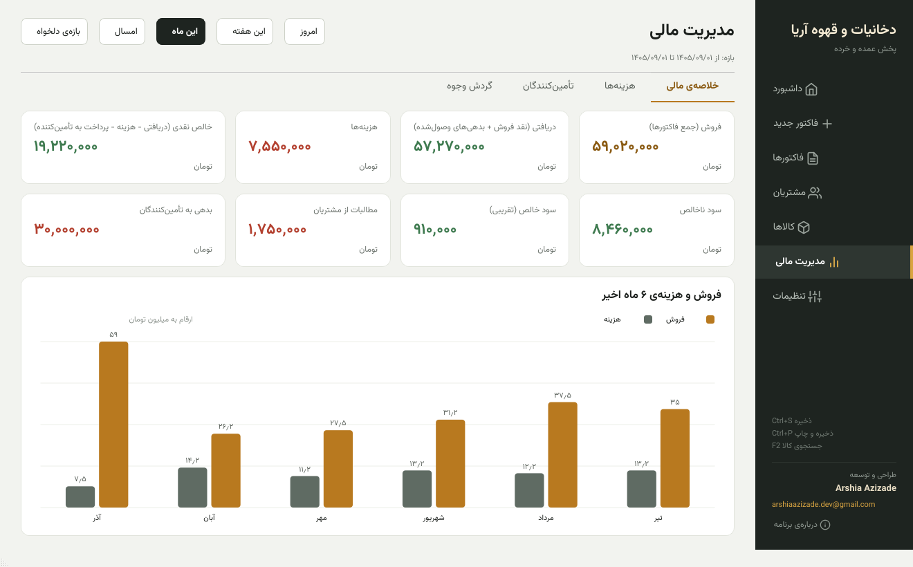
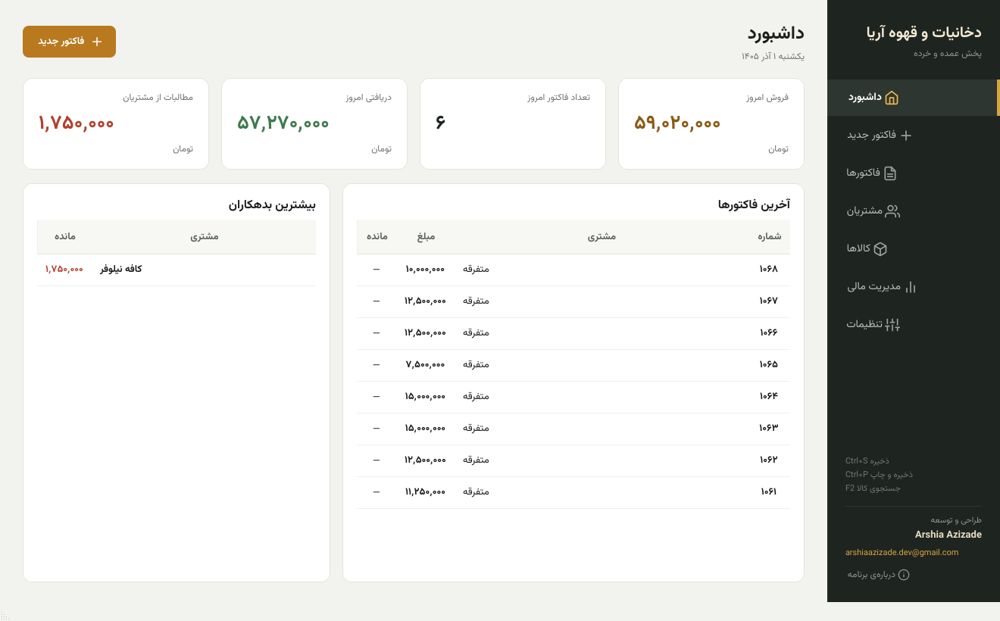
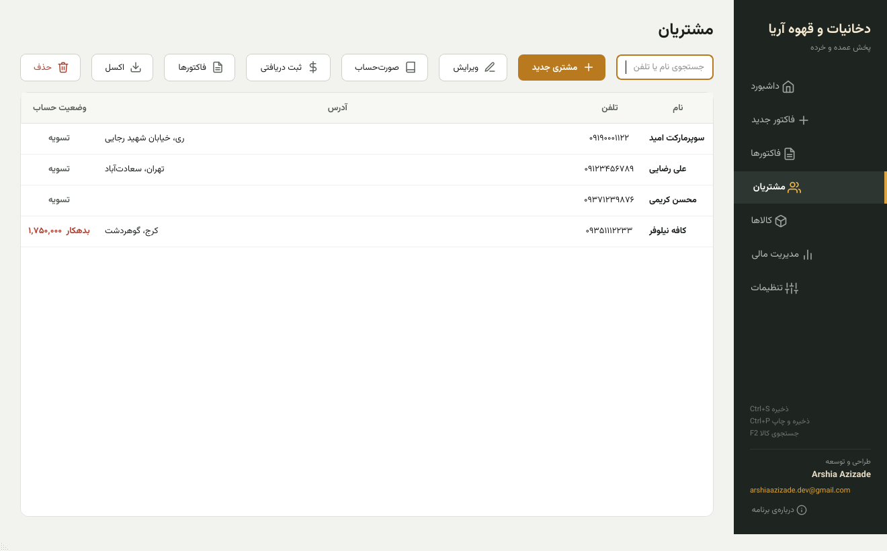
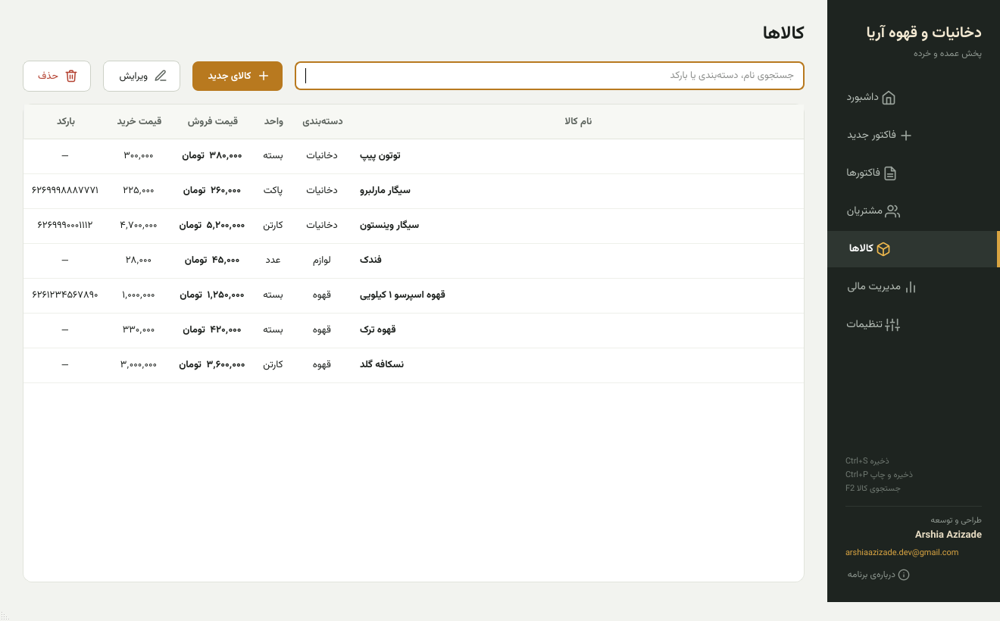
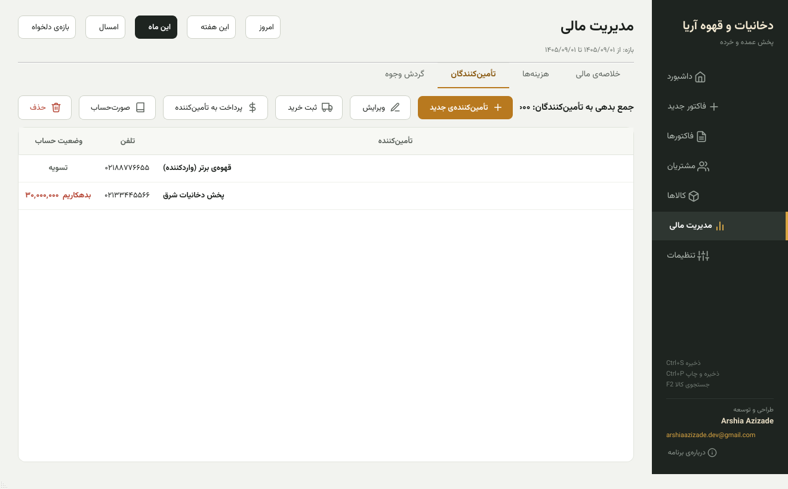
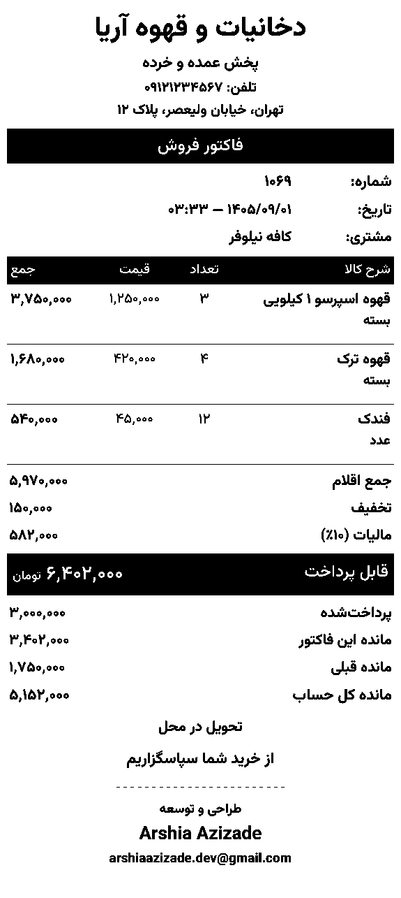
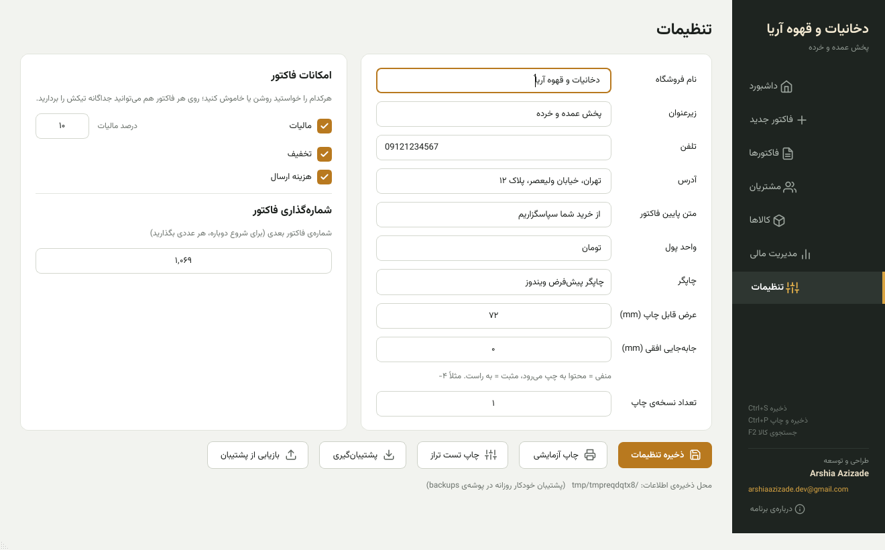

<div align="center">


# فاکتور فروش · Factor Foroosh

**نرم‌افزار آفلاین صدور فاکتور و مدیریت مالی برای فروشگاه‌های کوچک — فارسی (راست‌به‌چپ)، تاریخ شمسی، رسید ۸۰ میلی‌متری**

[](https://github.com/Arshia-Az/factor-foroosh/actions/workflows/ci.yml)
[](https://github.com/Arshia-Az/factor-foroosh/releases)
[](LICENSE)


[English](README.md) · فارسی

</div>

<p align="center">
  
  
</p>

<div dir="rtl" align="right">

فاکتور فروش یک برنامه‌ی دسکتاپ برای مغازه‌های خرده‌فروشی و عمده‌فروشی است (برای یک مرکز دخانیات و قهوه ساخته شده). مثل هر برنامه‌ی ویندوزی روی آیکنش کلیک می‌کنید و باز می‌شود. همه‌چیز در یک فایل SQLite روی همین کامپیوتر ذخیره می‌شود؛ بدون اینترنت، بدون اشتراک ماهانه، و بدون اینکه اطلاعاتی از کامپیوتر شما خارج شود.

## امکانات

**فروش**
- صفحه‌ی فاکتور سریع: انتخاب کالا از لیست قابل جستجو، تایپ یا اسکن بارکد، ویرایش تعداد و قیمت داخل جدول
- فروش نقدی و نسیه، پرداخت بخشی از مبلغ، نمایش مانده‌ی قبلی روی رسید
- **تخفیف**، **هزینه‌ی ارسال** و **مالیات** اختیاری؛ هرکدام را در تنظیمات و روی هر فاکتور جداگانه روشن یا خاموش کنید
- شماره‌ی فاکتور پشت‌سرهم که می‌توانید از هر عددی دوباره شروع کنید؛ ویرایش و کپی هر فاکتور ذخیره‌شده
- تاریخ شمسی در همه‌جا، ارقام فارسی و جداکننده‌ی سه‌رقمی همان لحظه‌ی تایپ

**چاپ**
- رسید **۸۰ میلی‌متری حرارتی** با درایور معمولی ویندوز (روی Meva TP-U1 تست شده)
- رسید به‌صورت تصویر سیاه‌وسفید ساخته می‌شود؛ بنابراین حروف فارسی درست چاپ می‌شوند و نوشته‌های ریز کمرنگ نمی‌شوند
- «جابه‌جایی افقی» و «چاپ تست تراز» برای هم‌ترازکردن رسید با پرینتر

**مشتری، کالا، تأمین‌کننده**
- حساب مشتری با مانده‌ی بدهکار/بستانکار، ثبت دریافتی و صورت‌حساب کامل هر مشتری
- کالا با دسته‌بندی، واحد، قیمت فروش، قیمت خرید و بارکد
- تأمین‌کنندگان با ثبت خرید، پرداخت و مانده

**مدیریت مالی**
- خلاصه‌ی مالی برای امروز / این هفته / این ماه / امسال / بازه‌ی دلخواه: فروش، دریافتی، هزینه‌ها، خالص نقدی، سود ناخالص و خالص، مطالبات و بدهی‌ها
- نمودار فروش و هزینه‌ی ۶ ماه اخیر، ثبت هزینه‌ها با دسته‌بندی، و گردش وجوه با تراز لحظه‌ای

**ایمن و مطمئن**
- پشتیبان خودکار روزانه، پشتیبان‌گیری و بازیابی دستی، خروجی اکسل (CSV)
- هنگام به‌روزرسانی، اطلاعات قبلی خودکار منتقل می‌شود؛ خطاها در فایل `error.log` ثبت می‌شوند و برنامه بی‌صدا از کار نمی‌افتد

## تصاویر

| | |
|---|---|
|  |  |
|  |  |
|  |  |

## نصب

### روش اول — دانلود برای ویندوز (بدون نیاز به پایتون)

1. به صفحه‌ی [Releases](https://github.com/Arshia-Az/factor-foroosh/releases) بروید و فایل `FactorForoosh-vX.Y.Z-windows.zip` را دانلود کنید.
2. فایل را در هر پوشه‌ای از حالت فشرده خارج کنید و `FactorForoosh.exe` را اجرا کنید (برای ساخت میانبر: راست‌کلیک ← Send to ← Desktop).

> چون فایل exe امضای دیجیتال ندارد، ممکن است ویندوز (SmartScreen) هشدار «ناشناس» بدهد. روی **More info** و بعد **Run anyway** بزنید.

### روش دوم — اجرا از سورس

به پایتون ۳٫۱۰ یا بالاتر نیاز دارد.

```bash
git clone https://github.com/Arshia-Az/factor-foroosh.git
cd factor-foroosh
pip install -r requirements.txt
python app.py
```

در ویندوز می‌توانید فقط روی `run.bat` دابل‌کلیک کنید.

### ساخت فایل exe

روی `build_exe.bat` دابل‌کلیک کنید. برنامه در پوشه‌ی `dist\FactorForoosh\` ساخته می‌شود.

## راه‌اندازی پرینتر

1. درایور پرینتر را نصب کنید و در Printer preferences اندازه‌ی کاغذ را روی **۸۰ میلی‌متر** بگذارید.
2. در برنامه: **تنظیمات ← چاپگر** را انتخاب کنید و «چاپ آزمایشی» بزنید.
3. اگر یک سمت رسید خالی بود یا بریده شد، «چاپ تست تراز» را بزنید و «جابه‌جایی افقی» را تنظیم کنید (راهنمای کامل: [docs/PRINTING.md](docs/PRINTING.md)).

## اطلاعات شما کجاست؟

| چه چیزی | کجا |
|---|---|
| دیتابیس | `%APPDATA%\ShopInvoice\shop.db` (ویندوز) · `~/ShopInvoice/shop.db` (لینوکس/مک) |
| پشتیبان‌های روزانه | `ShopInvoice\backups\` |
| گزارش خطا | `ShopInvoice\error.log` |

به‌روزرسانی هرگز اطلاعات را پاک نمی‌کند. برای انتقال به کامپیوتر دیگر، فایل `shop.db` را کپی کنید.

## میانبرهای صفحه‌کلید

| کلید | کار |
|---|---|
| `Ctrl+S` | ذخیره‌ی فاکتور |
| `Ctrl+P` | ذخیره و چاپ فاکتور |
| `F2` | رفتن به جستجوی کالا |
| `Ctrl+1` تا `Ctrl+7` | جابه‌جایی بین بخش‌ها |

## توسعه

</div>

```bash
python -m venv .venv && .venv\Scripts\activate        # Linux/macOS: source .venv/bin/activate
pip install -r requirements-dev.txt
ruff check .                                           # lint
pytest                                                 # headless end-to-end suite
python scripts/make_screenshots.py                     # regenerate docs/screenshots
```

<div dir="rtl" align="right">

ساختار پروژه و توضیح بخش‌های برنامه در [docs/ARCHITECTURE.md](docs/ARCHITECTURE.md) و راهنمای مشارکت در [CONTRIBUTING.md](CONTRIBUTING.md) آمده است (به انگلیسی).

## نسخه‌بندی و انتشار

پروژه از [نسخه‌بندی معنایی (SemVer)](https://semver.org/lang/fa/) پیروی می‌کند. شماره‌ی نسخه فقط در یک جا نگه‌داری می‌شود (`APP_VERSION` در `app.py`) و هر تغییر در [CHANGELOG.md](CHANGELOG.md) ثبت می‌شود.

</div>

```bash
python scripts/bump_version.py 1.4.0       # updates APP_VERSION and prints the next steps
# add a "## [1.4.0] - YYYY-MM-DD" section to CHANGELOG.md
git commit -am "chore: release v1.4.0"
git tag -a v1.4.0 -m "v1.4.0"
git push origin main --follow-tags
```

<div dir="rtl" align="right">

با ارسال تگ `vX.Y.Z`، GitHub Actions خودکار بررسی می‌کند تگ با `APP_VERSION` یکی باشد، تست‌ها را اجرا می‌کند، فایل exe ویندوز را می‌سازد و یک Release همراه فایل zip منتشر می‌کند.

## نقشه‌ی راه

- [ ] انبارداری (موجودی کالا که با هر فروش کم می‌شود)
- [ ] گزارش فروش ماهانه و سالانه (به تفکیک کالا و مشتری)
- [ ] امضای دیجیتال فایل ویندوز

پیشنهادها و Pull Request خوش‌آمدند — [CONTRIBUTING.md](CONTRIBUTING.md) را ببینید.

## مجوز و منابع

[MIT](LICENSE) © ۲۰۲۶ Arshia Azizade — <arshiaazizade.dev@gmail.com>

از PySide6، jdatetime، فونت وزیرمتن و شکل آیکن‌های Feather استفاده شده است — [THIRD_PARTY_NOTICES.md](THIRD_PARTY_NOTICES.md).

</div>
