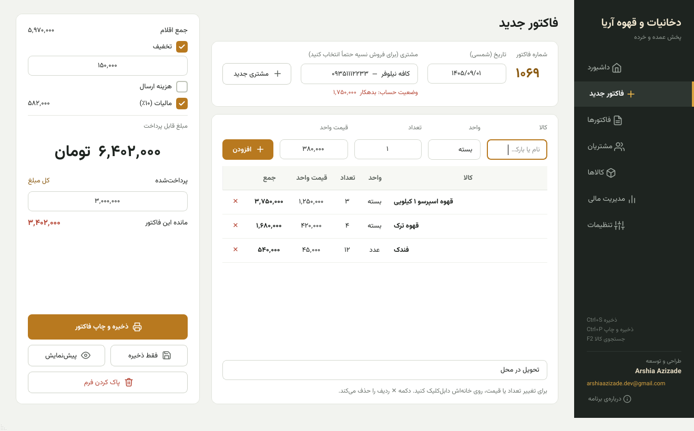
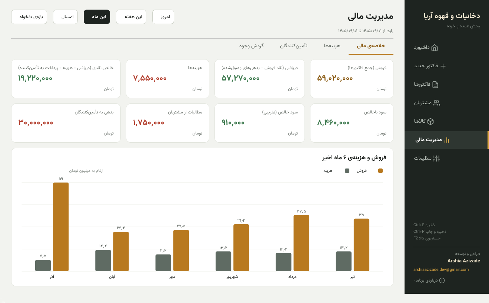
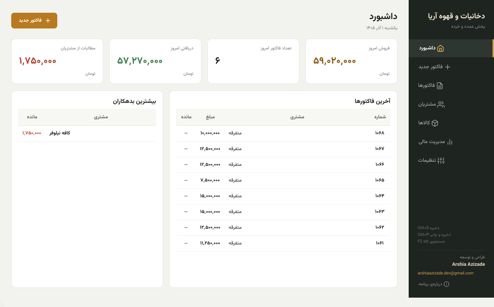
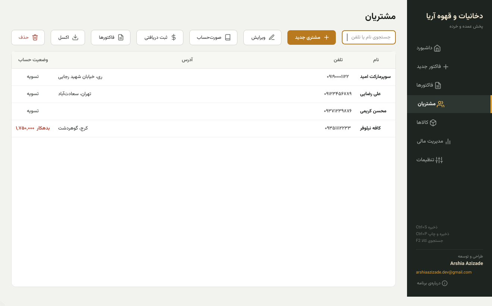
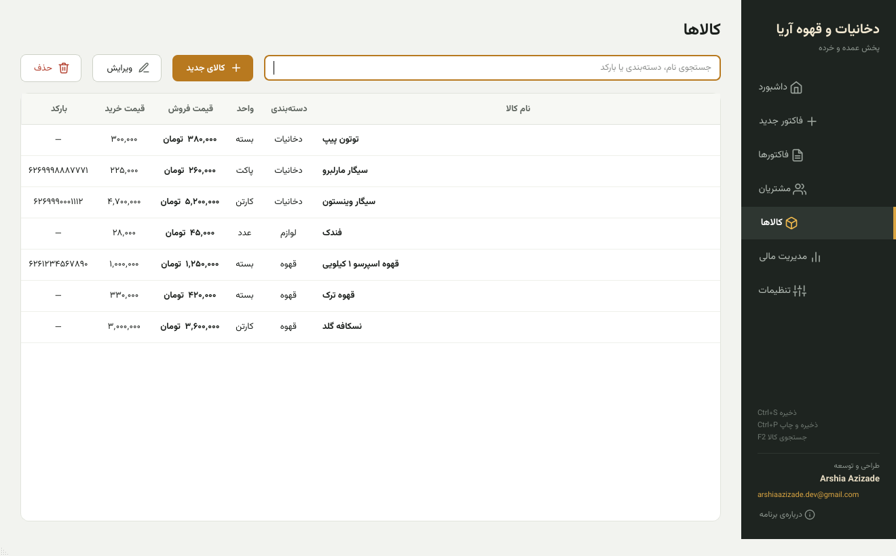
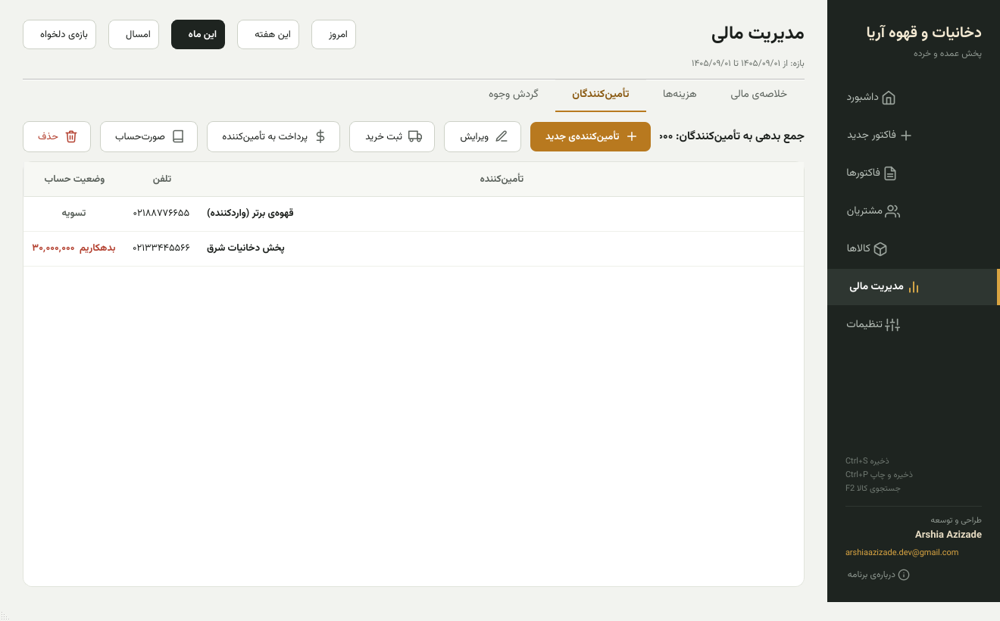
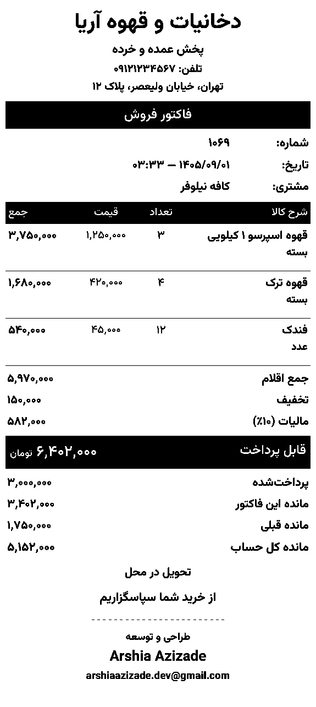
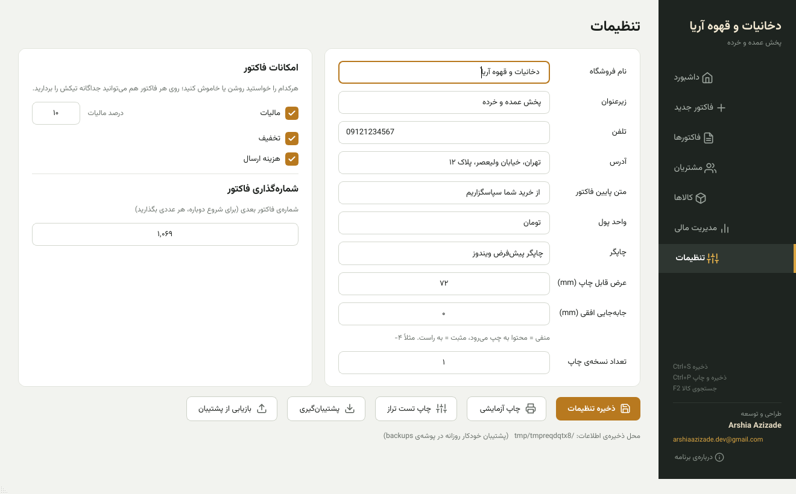

<div align="center">


# Factor Foroosh · فاکتور فروش

**Offline invoicing and finance for small shops — Persian/RTL, Shamsi dates, 80 mm thermal receipts.**

[](https://github.com/Arshia-Az/factor-foroosh/actions/workflows/ci.yml)
[](https://github.com/Arshia-Az/factor-foroosh/releases)
[](LICENSE)


English · [فارسی](README.fa.md)

</div>

<p align="center">
  
  
</p>

Factor Foroosh is a desktop app for a small retail or wholesale shop (it was built for a tobacco and coffee shop). You click an icon, it opens like any Windows program, and everything is stored locally in one SQLite file — no internet, no subscription, no data leaving your computer.

## Features

**Sales**
- Fast invoice screen: pick products from a searchable list, type or scan a barcode, edit quantity/price in the table
- Cash and credit sales, partial payments, previous-balance line on the receipt
- Optional **discount**, **shipping** and **tax** — switch each on or off in Settings and per invoice
- Sequential invoice numbers you can restart from any number; edit or copy any saved invoice
- Shamsi (Jalali) dates everywhere; Persian digits; thousands separators while you type

**Printing**
- Prints a clean **80 mm thermal receipt** through the normal Windows printer driver (tested with a Meva TP-U1)
- Receipt is rendered as a pure black-and-white bitmap, so Persian text is shaped correctly and small text stays dark
- Built-in horizontal offset and a **calibration print** to line the receipt up with your printer

**Customers, products, suppliers**
- Customer accounts with debit/credit balance, payments received, and a full statement per customer
- Products with category, unit, selling price, cost price and barcode
- Suppliers with purchases, payments and balance

**Finance**
- Overview for today / this week / this month / this year / any date range: sales, cash received, expenses, net cash, gross and net profit, receivables, payables
- Six-month sales-vs-expenses chart, expense tracking by category, cash-flow ledger with running balance

**Safe by default**
- Daily automatic backup, manual backup and restore, CSV export (opens in Excel)
- Existing databases are migrated automatically when you upgrade; errors are logged to `error.log` instead of crashing silently

## Screenshots

| | |
|---|---|
|  |  |
|  |  |
|  |  |

## Install

### Option A — Windows download (no Python needed)

1. Open the [Releases](https://github.com/Arshia-Az/factor-foroosh/releases) page and download `FactorForoosh-vX.Y.Z-windows.zip`.
2. Unzip it anywhere and run `FactorForoosh.exe` (right-click → *Send to → Desktop* for a shortcut).

> Windows SmartScreen may warn about an unknown publisher because the `.exe` is not code-signed. Click **More info → Run anyway**.

### Option B — Run from source

Requires Python 3.10+.

```bash
git clone https://github.com/Arshia-Az/factor-foroosh.git
cd factor-foroosh
pip install -r requirements.txt
python app.py
```

On Windows you can simply double-click `run.bat`.

### Build your own `.exe`

Double-click `build_exe.bat` (or run it in a terminal). The program appears in `dist\FactorForoosh\`.

## Printer setup

1. Install the printer driver and set the paper size to **80 mm** in *Printer preferences*.
2. In the app: **Settings → Printer**, choose your printer, press **Test print**.
3. If one side of the receipt is empty or cut off, use **Test alignment print** and adjust *Horizontal offset* (see [docs/PRINTING.md](docs/PRINTING.md)).

## Your data

| What | Where |
|---|---|
| Database | `%APPDATA%\ShopInvoice\shop.db` (Windows) · `~/ShopInvoice/shop.db` (Linux/macOS) |
| Daily backups | `ShopInvoice\backups\` |
| Error log | `ShopInvoice\error.log` |

Upgrading never deletes data. Copy `shop.db` to move to another computer.

## Keyboard shortcuts

| Key | Action |
|---|---|
| `Ctrl+S` | Save invoice |
| `Ctrl+P` | Save and print invoice |
| `F2` | Jump to product search |
| `Ctrl+1` … `Ctrl+7` | Switch between sections |

## Development

```bash
python -m venv .venv && .venv\Scripts\activate        # Linux/macOS: source .venv/bin/activate
pip install -r requirements-dev.txt
ruff check .                                           # lint
pytest                                                 # headless end-to-end suite
python scripts/make_screenshots.py                     # regenerate docs/screenshots
```

```
factor-foroosh/
├── app.py                  # the application (sections documented at the top of the file)
├── fonts/                  # Vazirmatn (SIL OFL)
├── assets/                 # icon, logo, social preview
├── docs/                   # architecture, printing guide, screenshots
├── scripts/                # bump_version.py, make_screenshots.py
├── tests/                  # run_checks.py (end-to-end) + pytest wrapper
├── .github/                # CI, release workflow, issue/PR templates
├── run.bat / build_exe.bat # Windows helpers (ASCII + CRLF on purpose)
└── requirements*.txt
```

More in [docs/ARCHITECTURE.md](docs/ARCHITECTURE.md) and [CONTRIBUTING.md](CONTRIBUTING.md).

## Versioning and releases

The project follows [Semantic Versioning](https://semver.org/). The version lives in one place — `APP_VERSION` in `app.py` — and every change is recorded in [CHANGELOG.md](CHANGELOG.md).

```bash
python scripts/bump_version.py 1.4.0       # updates APP_VERSION and prints the next steps
# add a "## [1.4.0] - YYYY-MM-DD" section to CHANGELOG.md
git commit -am "chore: release v1.4.0"
git tag -a v1.4.0 -m "v1.4.0"
git push origin main --follow-tags
```

Pushing a `vX.Y.Z` tag triggers GitHub Actions, which verifies the tag matches `APP_VERSION`, runs the tests, builds the Windows `.exe` and publishes a GitHub Release with the zip attached.

## Roadmap

- [ ] Inventory (stock levels that drop on every sale)
- [ ] Monthly and yearly sales reports (per product, per customer)
- [ ] Optional code-signing for the Windows build

Ideas and pull requests are welcome — see [CONTRIBUTING.md](CONTRIBUTING.md).

## License and credits

[MIT](LICENSE) © 2026 Arshia Azizade — <arshiaazizade.dev@gmail.com>

Uses PySide6, jdatetime, the Vazirmatn font and Feather icon shapes — see [THIRD_PARTY_NOTICES.md](THIRD_PARTY_NOTICES.md).
